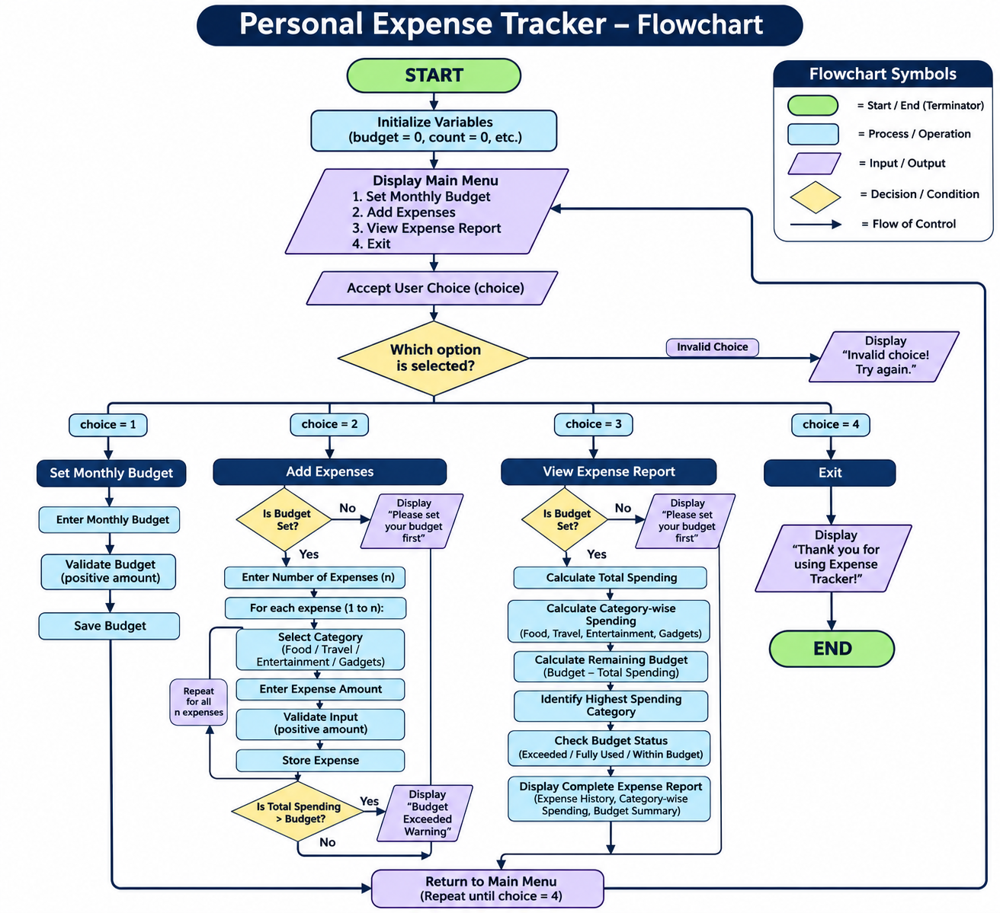
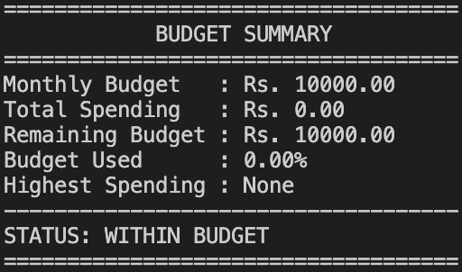

# Personal Expense Tracker

### C Programming Mini Hackathon

**University:** UPES, Dehradun  
**Course:** C Programming Lab  
**Batch:** 35  
**Presented To:** Arti Bahuguna Ma'am  

---

## Team Members

| Name | SAP ID |
|------|--------|
| Adil Pandole | 590037391 |
| Srishti Gupta | 590037151 |
| Pulkit Garg | 590040463 |

---

## 1. Project Description

The Personal Expense Tracker is a menu-driven application
developed using the C programming language.

The application helps college students manage their monthly
budgets, record daily expenses, and analyze their spending.

It organizes expenses into four categories:

1. Food
2. Travel
3. Books
4. Entertainment

The program automatically calculates total spending,
remaining budget, and the highest spending category.

It also warns users when their monthly budget is exceeded.

---

## 2. Problem Statement

Managing daily expenses can be challenging for college
students, especially when working with limited monthly funds.

Students often struggle with:

- Tracking daily expenditures.
- Managing their monthly allowances.
- Identifying unnecessary spending.
- Monitoring their remaining budget.
- Avoiding overspending.

The Personal Expense Tracker provides a simple solution
to these problems using fundamental C programming concepts.

---

## 3. Project Objectives

The main objectives of this project are:

- Develop a menu-driven application using C programming.
- Allow users to set their monthly budget.
- Record multiple expenses.
- Categorize expenses into four predefined categories.
- Automatically calculate total expenditure.
- Display the remaining monthly budget.
- Identify the category with the highest spending.
- Generate warnings when the budget is exceeded.
- Demonstrate fundamental C programming concepts.

---

## 4. Features

### 4.1 Monthly Budget Management

Users can enter and update their monthly budget.

### 4.2 Multiple Expense Entry

Users can record multiple expenses in a single operation.

### 4.3 Expense Categorization

Expenses are divided into four categories:

1. Food
2. Travel
3. Books
4. Entertainment

### 4.4 Automatic Calculations

The program automatically calculates:

- Total expenditure.
- Remaining budget.
- Percentage of budget utilized.
- Category-wise expenditure.

### 4.5 Expense Report

The program generates a report containing:

- Expense history.
- Category-wise spending.
- Monthly budget.
- Total expenditure.
- Remaining balance.
- Highest spending category.
- Budget status.

### 4.6 Budget Alerts

The program displays a warning when spending exceeds
the monthly budget.

### 4.7 Input Validation

The application rejects:

- Invalid menu selections.
- Negative or zero expense amounts.
- Invalid expense categories.
- Invalid monthly budgets.

---

## 5. Main Menu

The application provides four menu options:

```text
====================================
       PERSONAL EXPENSE TRACKER
====================================

1. Set Monthly Budget
2. Add Expenses
3. View Expense Report
4. Exit

------------------------------------
Enter your choice:
```

### Menu Operations

**Option 1: Set Monthly Budget**

Allows the user to enter or update the monthly budget.

**Option 2: Add Expenses**

Allows the user to record multiple expenses under
Food, Travel, Books, or Entertainment.

**Option 3: View Expense Report**

Displays the complete expense history, category-wise
spending, and budget summary.

**Option 4: Exit**

Terminates the application.

---

## 6. Algorithm

**Step 1:** Start the program.

**Step 2:** Initialize the monthly budget, expense records,
and other required variables.

**Step 3:** Display the main menu:

1. Set Monthly Budget
2. Add Expenses
3. View Expense Report
4. Exit

**Step 4:** Accept the user's menu choice.

**Step 5:** Perform the selected operation.

- If choice is 1, accept and validate the monthly budget.
- If choice is 2, accept the number of expenses and record
  each expense under its selected category.
- If choice is 3, calculate and display the expense report.
- If choice is 4, exit the application.
- Otherwise, display an invalid choice message.

**Step 6:** Calculate total expenditure.

**Step 7:** Calculate the remaining budget using:

```text
Remaining Budget = Monthly Budget - Total Expenses
```

**Step 8:** Calculate category-wise expenditure.

**Step 9:** Identify the category with the highest spending.

**Step 10:** Check the budget status.

- If Total Spending > Budget: Budget Exceeded.
- If Total Spending = Budget: Budget Fully Used.
- If Total Spending < Budget: Within Budget.

**Step 11:** Display the complete expense report when requested.

**Step 12:** Return to the main menu.

**Step 13:** Repeat until the user selects Exit.

**Step 14:** End the program.

---

## 7. Flowchart

The following flowchart illustrates the working
of the Personal Expense Tracker.



---

## 8. C Programming Concepts Used

The application uses fundamental C programming concepts.

| Concept | Application |
|---------|-------------|
| Variables | Store budgets and expense values |
| Conditional Statements | Validate inputs and check budget limits |
| Loops | Repeat menu operations and record expenses |
| Arrays | Store multiple expense records |
| Structures | Organize expense amounts and categories |
| Functions | Divide the program into smaller operations |
| Switch Statement | Execute selected menu operations |
| Input/Output | Accept inputs and display results |
| Preprocessor Directives | Define program constants |

### Functions Used

**1. setBudget()**

Accepts and validates the monthly budget.

**2. addExpenses()**

Allows users to enter multiple expenses.

**3. totalExpenses()**

Calculates the total expenditure.

**4. viewReport()**

Displays expense history, category-wise spending,
and the complete budget summary.

**5. readAmount()**

Validates monetary inputs.

**6. clearInput()**

Clears invalid input from the input buffer.

---

## 9. How to Compile and Run

### Requirements

- GCC or Clang C compiler.
- Visual Studio Code or another compatible editor.
- Windows, macOS, or Linux.

### Step 1: Download the Project

Download the repository and open the project folder.

### Step 2: Open Terminal

Open the integrated terminal in Visual Studio Code.

### Step 3: Compile the Program

For macOS and Linux:

```bash
gcc Personal_Expense_Tracker.c -o expense_tracker
```

For Windows:

```bash
gcc Personal_Expense_Tracker.c -o expense_tracker.exe
```

### Step 4: Run the Program

For macOS and Linux:

```bash
./expense_tracker
```

For Windows:

```bash
.\expense_tracker.exe
```

### Step 5: Use the Application

1. Select Option 1 to set your monthly budget.
2. Select Option 2 to add expenses.
3. Select Option 3 to view your expense report.
4. Select Option 4 to exit.

---

## 10. Sample Test Cases and Outputs

Five test scenarios were used to check the program's
functionality.

### Test Case 1: Normal Expense Tracking

**Input:**

Monthly Budget: Rs. 10000

Number of Expenses: 4

| Category | Amount |
|----------|--------|
| Food | Rs. 2500 |
| Travel | Rs. 1200 |
| Books | Rs. 800 |
| Entertainment | Rs. 1500 |

**Expected Output:**

```text
Monthly Budget   : Rs. 10000.00
Total Spending   : Rs. 6000.00
Remaining Budget : Rs. 4000.00
Budget Used      : 60.00%
Highest Spending : Food
STATUS: WITHIN BUDGET
```

**Actual Output:** Matches the expected output.

**Result:** PASS

---

### Test Case 2: Budget Exceeded

**Input:**

Monthly Budget: Rs. 5000

Number of Expenses: 3

| Category | Amount |
|----------|--------|
| Food | Rs. 2000 |
| Travel | Rs. 1500 |
| Books | Rs. 3000 |

**Expected Output:**

```text
Monthly Budget   : Rs. 5000.00
Total Spending   : Rs. 6500.00
Remaining Budget : Rs. -1500.00
Budget Used      : 130.00%
Highest Spending : Books
STATUS: BUDGET EXCEEDED!
```

**Actual Output:** Matches the expected output.

**Result:** PASS

**Screenshot:**


---

### Test Case 3: Invalid Expense Amount

**Input:**

Monthly Budget: Rs. 8000

Category: Food

Expense Amount: Rs. -500

**Expected Output:**

```text
Invalid amount! Try again.
```

**Actual Output:** The program rejected the negative amount
and requested a valid expense entry.

**Result:** PASS

**Screenshot:**


---

### Test Case 4: Invalid Menu Selection

**Input:**

Menu Choice: 9

**Expected Output:**

```text
Invalid choice! Try again.
```

**Actual Output:** The program displayed the error message
and returned to the main menu.

**Result:** PASS

---

### Test Case 5: No Expenses Recorded

**Input:**

Monthly Budget: Rs. 10000

Select Option 3 without adding expenses.

**Expected Output:**

```text
No expenses recorded yet.

Monthly Budget   : Rs. 10000.00
Total Spending   : Rs. 0.00
Remaining Budget : Rs. 10000.00
Budget Used      : 0.00%
Highest Spending : None
STATUS: WITHIN BUDGET
```

**Actual Output:** Matches the expected output.

**Result:** PASS

**Screenshot:**



---

## 11. Testing Summary

| Test Case | Expected Result | Status |
|-----------|-----------------|--------|
| Normal Expense Tracking | Correct expense calculations | PASS |
| Budget Exceeded | Budget warning displayed | PASS |
| Invalid Expense Amount | Negative amount rejected | PASS |
| Invalid Menu Selection | Invalid choice handled | PASS |
| No Expenses Recorded | Empty expense report handled | PASS |

**Total Test Cases:** 5

**Passed:** 5

**Failed:** 0

---

## 12. Limitations

- The application uses a command-line interface.
- Expense records are stored temporarily in memory.
- Data is cleared when the program closes.
- The application supports a maximum of 100 expenses.
- The program uses four predefined expense categories.

---

## 13. Future Scope

The project can be improved by adding:

1. File handling for permanent expense storage.
2. Monthly expense comparisons.
3. Exportable expense reports.
4. Graphical user interface.
5. Advanced spending analytics.
6. Expense filtering and searching.

---

## 14. Conclusion

The Personal Expense Tracker demonstrates how fundamental
C programming concepts can be used to solve practical
financial management problems.

The application allows students to record expenses,
monitor spending, and manage monthly budgets.

The project demonstrates:

- Structured programming.
- Logical problem-solving.
- Input validation.
- Expense analysis.
- Team collaboration.

### Track Smarter. Spend Wiser.

---

## Project Information

**Project:** Personal Expense Tracker  
**Event:** C Programming Mini Hackathon  
**University:** UPES, Dehradun  
**Course:** C Programming Lab  
**Batch:** 35  

**Presented To:** Arti Bahuguna Ma'am

**Developed By:**

- Adil Pandole — 590037391
- Srishti Gupta — 590037151
- Pulkit Garg — 590040463